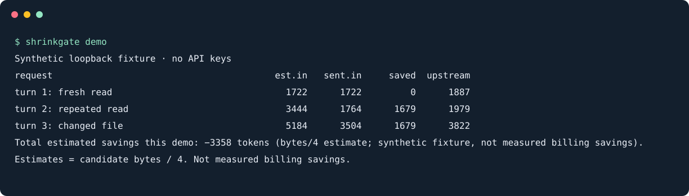

<div align="center">

# ShrinkGate

**Stop sending identical tool output twice.**

A local Rust gateway that removes duplicate tool results from coding-agent requests before forwarding them to your model provider.

[](https://crates.io/crates/shrinkgate)
[](https://github.com/KotalaKishanReddy/shrinkgate/actions/workflows/ci.yml)
[](https://github.com/KotalaKishanReddy/shrinkgate/releases)
[](LICENSE)

Claude Code / Codex / OpenCode → **127.0.0.1:18793** → Your provider

</div>



[Replay the recorded terminal demo](docs/demo.cast) with `asciinema play docs/demo.cast` (paced for readability).

## Try it

```sh
cargo install shrinkgate --locked
shrinkgate demo                    # Synthetic local fixture; no API keys
shrinkgate connect claude --dry-run # Inspect the proposed configuration
shrinkgate connect claude           # Or: codex / opencode
shrinkgate doctor
shrinkgate stats --json
```

**The changes on `main` under “Unreleased” are not yet on crates.io or in v0.1.2 binaries.** To try this revision now:

```sh
git clone https://github.com/KotalaKishanReddy/shrinkgate.git
cd shrinkgate
cargo install --path . --locked
```

Start a new agent session after connecting. API keys stay in your agent or environment. ShrinkGate forwards authentication to the configured upstream; it does not provide model access.

### Install a verified release binary

No Rust toolchain or root access required. Download the installer, inspect it, then run it:

```sh
curl --proto '=https' --tlsv1.2 -fsSLo install-shrinkgate.sh \
  https://raw.githubusercontent.com/KotalaKishanReddy/shrinkgate/main/scripts/install.sh
sh install-shrinkgate.sh
# Optional: SHRINKGATE_VERSION=v0.1.2 SHRINKGATE_INSTALL_DIR="$HOME/.local/bin" sh install-shrinkgate.sh
```

Windows x64 (PowerShell):

```powershell
Invoke-WebRequest https://raw.githubusercontent.com/KotalaKishanReddy/shrinkgate/main/scripts/install.ps1 -OutFile install-shrinkgate.ps1
# Inspect install-shrinkgate.ps1, then:
./install-shrinkgate.ps1
```

Installers download the matching release archive and verify its SHA-256 checksum **before extraction**. Checksums detect corrupt downloads; they are not an independent publisher signature. [Manual downloads](https://github.com/KotalaKishanReddy/shrinkgate/releases).

## What it actually saves

If a request contains the same sufficiently large tool result multiple times, ShrinkGate replaces earlier copies outside the protected tail with a short content-hash stub. The last identical copy remains verbatim. A file with changed content has a different hash and stays distinct.

**Replaying history alone does not produce savings.** A payload present once in each request stays intact; duplicates must exist within the current request. The transformer retains no cross-request content cache, eliminating persistent fingerprint growth and the old global session lock.

- Tool results are eligible by default. User instructions, assistant prose, system/developer prompts, reasoning, schemas, and media are protected by default.
- Exact duplicate text is retained, but removing historical copies can affect interpretation and ordering. This is not a guarantee of unchanged model behavior.
- Moving the retained copy can change the historical prefix and invalidate provider prompt caches. Lower request size does **not** guarantee lower billed cost or latency.
- Local token-reduction counters use candidate UTF-8 bytes ÷ 4. Provider usage is shown separately. No universal percentage or dollar savings is claimed.

Run the [benchmark suite](docs/BENCHMARKS.md) to see repeated, unique, changed-file, and short-output cases across all three API formats. [Recorded local results](docs/benchmark.json) measure bytes and processing time, not real API billing or task quality.

## Agent compatibility

| Integration | Configuration | Validation / limits |
| --- | --- | --- |
| Claude Code | `connect claude [--lean] [--statusline]` | Anthropic Messages fixtures and config restore tested; current live agent versions need manual validation |
| Codex | `connect codex [--env-key OPENAI_API_KEY]` | Responses fixtures tested; ChatGPT login routing supported but live authentication not verified by CI; profiles refused |
| OpenCode | `connect opencode` | Adds providers without changing your model; explicit Meta/Zen routing; choose a `shrinkgate/` model |
| Muse | `connect muse` | Experimental helper only; requires `default_upstream = "meta"`; no live compatibility claim |
| Other clients | `env` | HTTP Messages, Chat Completions, or Responses; no WebSocket support |

Linux, macOS, and Windows CI runs build/tests. No specific agent version is certified by this test suite. See the [compatibility and release checklist](docs/COMPATIBILITY.md).

## Commands

| Command | Purpose |
| --- | --- |
| `serve [--port N] [--no-shrink]` | Foreground gateway; `--no-shrink` preserves request body bytes for comparison |
| `connect <agent> [--dry-run] [--no-service]` | Preview or connect; persistent recovery snapshot; reconnect preserves the original backup |
| `uninstall <agent>` | Restore settings if they still match; externally changed values and their recovery data are retained |
| `doctor` | Check local engine identity/version, config and wiring; no provider credentials sent |
| `status [agent]` / `stats [--json]` | Wiring status, estimated successful-request reductions, provider usage, failed attempts |
| `demo` | Asserted three-turn loopback proxy demo |
| `benchmark [--input request.json] [--iterations 100]` | Local transform/serialization benchmark; no network calls |
| `lean on\|off\|status` | Optional Claude compaction setting; independent of other managed settings |
| `env` / `config` / `statusline` | Manual routing, resolved configuration, or terminal summary |

`--dry-run` displays your resulting agent configuration: avoid sharing its output if your original settings contain secrets. Uninstall before changing connection options or the gateway port. `uninstall <agent> --purge` refuses to delete shared state while other integrations or a listening engine remain; stop detached engines first. ShrinkGate refuses to silently overwrite changed recovery state.

## Configuration

`~/.config/shrinkgate/config.toml` (honors `XDG_CONFIG_HOME`):

```toml
port = 18793
shrink = true
min_block_bytes = 600
keep_last_messages = 2
allow_user_text = false       # Opt-in; repeated instructions may be intentional
allow_assistant_text = false
# upstream_openai = "https://api.openai.com"  # Do not include /v1
# default_upstream = "openai"
```

Restart the daemon after changes. Invalid/unknown options fail explicitly. The old `max_sessions` key is accepted but ignored because transforms are stateless. Responses API tail protection counts input items, including tool-call items.

Operational defaults: 16 concurrent HTTP connections, 16 MiB transformed request limit, 64 MiB buffered non-streaming response limit, 10-second upstream connect timeout, 120-second request-body/upstream-header/non-streaming-response timeout, and 15-second incoming header timeout. Responses stream incrementally; an open SSE stream has no fixed lifetime limit. Shutdown drains connections for up to 10 seconds. These limits are compiled defaults.

## Privacy and operations

No telemetry. Traffic is forwarded to your configured providers over HTTPS; HTTP is allowed only for loopback upstreams. Other local processes under your account can reach the daemon. Browser-origin requests and non-loopback Host headers are rejected. The daemon is intended for a trusted, single-user workstation, not an exposed or multi-tenant service.

Local journals contain timestamps, route, a pseudonymous session fingerprint, status, latency and usage metadata—not prompts or auth headers. Two rotated journals retain approximately 16 MiB; statistics describe retained history, with UTC day boundaries. Failed/cancelled requests do not earn savings credit. Agent recovery snapshots may include secrets already present in original settings and are written privately on Unix; Windows relies on your profile directory ACLs. See [SECURITY.md](SECURITY.md).

### Docker (Linux host networking)

```sh
docker run --rm --network host \
  -v shrinkgate-state:/data \
  ghcr.io/kotalakishanreddy/shrinkgate:latest
```

The published image tracks tagged releases. Use a dedicated volume: the runtime runs as an unprivileged user. Docker Desktop requires supported/enabled host networking; prefer native binaries otherwise. Do not expose the loopback gateway publicly.

## Contribute

See [CONTRIBUTING.md](CONTRIBUTING.md), [roadmap](docs/ROADMAP.md), [audit and validation](docs/AUDIT.md), and [changelog](CHANGELOG.md). If ShrinkGate helps your workflow, a star and an anonymized benchmark report help others evaluate it.

Apache-2.0. Not affiliated with Anthropic, OpenAI, Meta, or Context Shrink LLC.
