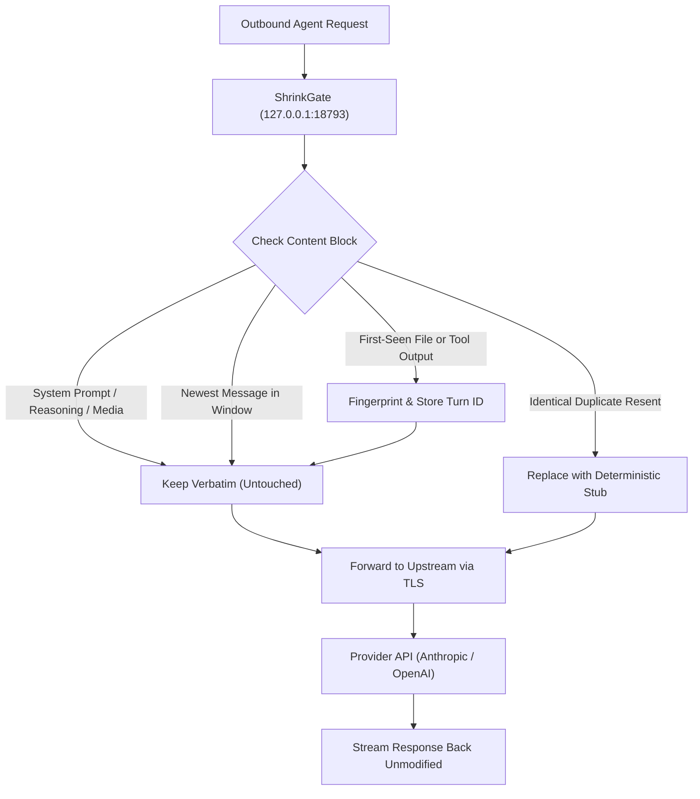

<div align="center">

# ⚡ ShrinkGate

### *High-performance, local context-shrinking gateway for coding agents.*

[](https://github.com/KotalaKishanReddy/shrinkgate/actions/workflows/ci.yml)
[](https://crates.io/crates/shrinkgate)
[](https://crates.io/crates/shrinkgate)
[](https://github.com/KotalaKishanReddy/shrinkgate/releases)
[](https://github.com/KotalaKishanReddy/shrinkgate/pkgs/container/shrinkgate)
[](LICENSE)
[](https://github.com/KotalaKishanReddy/shrinkgate)
[](https://github.com/KotalaKishanReddy/shrinkgate)

<br/>

**A lightweight (~2.3 MB) local daemon on `127.0.0.1:18793` that cuts your coding agent token costs and latency by deduplicating conversation history before it reaches LLM APIs.**

*Built from scratch in safe, idiomatic Rust for Linux & macOS. An open-source alternative to proprietary context compressors.*

<br/>

```text
 ┌──────────────┐
 │  Claude Code │────┐
 └──────────────┘    │
 ┌──────────────┐    │       ┌───────────────────────┐         ┌────────────────────────┐
 │ OpenAI Codex │────┼──────►│  ⚡ ShrinkGate         │────────►│  Official Model APIs   │
 └──────────────┘    │       │  127.0.0.1:18793      │         │  (Anthropic / OpenAI / │
 ┌──────────────┐    │       │  • Deduplicates Turns │         │   Meta / OpenCode)     │
 │   OpenCode   │────┤       │  • Preserves Caches   │         └────────────────────────┘
 └──────────────┘    │       │  • Streams Untouched  │                     ▲
 ┌──────────────┐    │       └───────────────────────┘                     │
 │   Muse Code  │────┘                   │                                 │
 └──────────────┘                        └──────── Pass-through Auth ──────┘
```

</div>

---

## 💡 Why ShrinkGate?

Coding agents (Claude Code, Codex, OpenCode, Aider, etc.) resend the **entire accumulated conversation history** on every single turn—including large file reads, long shell outputs, test logs, and search results.

As your session grows from 10 to 50 turns:
- 💸 **Token bills skyrocket**: You pay for the same 20KB file read 40 times over.
- 🐢 **Latency slows down**: Uploading megabytes of redundant context adds network and inference delay.
- 📉 **Context limits trigger early**: Hitting 100k or 200k context windows prematurely forces lossy compaction.

**ShrinkGate fixes this silently on localhost.** It intercepts the outbound JSON request, fingerprints repeated data with length-prefixed SHA-256, replaces earlier duplicate payloads with deterministic stubs, and streams the response back with **zero modification to model output**.

---

## ✨ Features at a Glance

| Feature | Description |
| :--- | :--- |
| **🚀 Sub-Millisecond Overhead** | Zero-copy streaming powered by Hyper 1.0, Tokio, and Rustls. Adds `<0.5ms` to request cycles. |
| **🔒 100% Local & Private** | Strictly binds to `127.0.0.1`. No telemetry, no external accounts, no cloud dependencies. |
| **🎯 Prompt-Cache Friendly** | Replacement stubs are strictly deterministic, keeping upstream prompt cache hit rates at maximum efficiency. |
| **🛡️ Safe by Design** | System prompts, function definitions, thinking/reasoning blocks, and media payloads are **never modified**. |
| **🔄 Zero-Downtime Agent Wiring** | One-command setup (`shrinkgate connect`) with atomic config backups and clean rollback (`shrinkgate uninstall`). |
| **📦 Tiny Static Footprint** | Compiled with LTO, stripping, and size optimization into a single self-contained ~2.3 MB binary. |

---

## 📊 Live Savings Demo

Run the built-in 3-turn integration fixture directly from your terminal:

```sh
shrinkgate demo
```

```text
ShrinkGate demo — gateway :39481 → mock upstream :41029

request                                        est.in   sent.in     saved  upstream
turn 1: read payments.rs (fresh read)            2800      2800         0      2800
turn 2: same history resent + a follow-up        5642      2884     +2758      2884
turn 3: history resent again, file edited once   8484      5684     +2800      5684

Total estimated savings this demo: −5,558 tokens (deterministic stubs, prompt-cache friendly).
Journal: /tmp/shrinkgate-demo/usage.jsonl
```

---

## ⚡ Quick Start

### 1. Install ShrinkGate

Choose your preferred installation method:

#### Option A: Cargo (Crates.io)
If you have Rust installed, install the latest release directly:
```sh
cargo install shrinkgate
```

#### Option B: Prebuilt Binaries (Linux & macOS)

Download and install the self-contained ~2.3 MB binary from [GitHub Releases](https://github.com/KotalaKishanReddy/shrinkgate/releases/latest):

**🐧 Linux (x86_64):**
```sh
curl -sSL https://github.com/KotalaKishanReddy/shrinkgate/releases/latest/download/shrinkgate-v0.1.0-x86_64-linux.tar.gz | tar -xz
sudo mv shrinkgate /usr/local/bin/
```

**🍏 macOS (Apple Silicon M1/M2/M3/M4):**
```sh
curl -sSL https://github.com/KotalaKishanReddy/shrinkgate/releases/latest/download/shrinkgate-v0.1.0-aarch64-macos.tar.gz | tar -xz
sudo mv shrinkgate /usr/local/bin/
```

**🍏 macOS (Intel x86_64):**
```sh
curl -sSL https://github.com/KotalaKishanReddy/shrinkgate/releases/latest/download/shrinkgate-v0.1.0-x86_64-macos.tar.gz | tar -xz
sudo mv shrinkgate /usr/local/bin/
```

#### Option C: Docker Container
```sh
docker run -d --name shrinkgate --network host --restart always \
  -v ~/.local/state/shrinkgate:/data \
  ghcr.io/kotalakishanreddy/shrinkgate:latest
```

#### Option D: Build from Source (Rust 1.85+)
```sh
git clone https://github.com/KotalaKishanReddy/shrinkgate.git
cd shrinkgate
cargo build --release
sudo mv target/release/shrinkgate /usr/local/bin/
```

---

### 2. Connect Your Coding Agent

Wire any supported agent with a single command:

```sh
# Claude Code (auto-configures ANTHROPIC_BASE_URL, session hooks, and statusline)
shrinkgate connect claude

# OpenAI Codex (wires base_url and responses wire_api in ~/.codex/config.toml)
shrinkgate connect codex

# OpenCode (registers local shrinkgate provider in opencode.json)
shrinkgate connect opencode

# Muse Code (generates helper environment file)
shrinkgate connect muse
```

Check system status and live savings at any time:
```sh
shrinkgate status
```

---

## 🔍 How the Shrink Pass Works



### The Guarantee Matrix

| Content Type | ShrinkGate Behavior | Reason |
| :--- | :---: | :--- |
| **System Prompts & Developer Instructions** | 🔒 **Untouched** | Agent instructions must never be corrupted. |
| **Tool / Function Definitions** | 🔒 **Untouched** | Schema definitions must match model expectations. |
| **Thinking / Reasoning Blocks** | 🔒 **Untouched** | Reasoning traces are non-reproducible. |
| **Images & Multimodal Blobs** | 🔒 **Untouched** | Binary media cannot be stubbed safely. |
| **Newest Message Window** (`keep_last_messages`) | 🔒 **Untouched** | Immediate conversational context remains 100% intact. |
| **Repeated File Reads / Tool Results** | ✂️ **Stubbed** | Replaced with informative, cache-stable reference stub. |

When an identical file read or tool output is resent on subsequent turns, older copies are replaced with:
```text
[shrinkgate] unchanged content — an identical copy was already sent earlier
in this conversation (first seen in request #3, 18422 bytes). This duplicate
was trimmed locally to save context; the original text above is still accurate.
```

---

## 🔌 Supported Agents

<details open>
<summary><b>Anthropic Claude Code</b></summary>

```sh
shrinkgate connect claude [--lean] [--statusline]
```
- Sets `env.ANTHROPIC_BASE_URL` to `http://127.0.0.1:18793`.
- Installs `SessionStart` auto-launch hook.
- `--lean`: Caps auto-compact threshold at 200k tokens.
- `--statusline`: Displays today's cumulative token savings in your terminal statusline.
</details>

<details>
<summary><b>OpenAI Codex</b></summary>

```sh
shrinkgate connect codex [--env-key OPENAI_API_KEY]
```
- Safely edits `~/.codex/config.toml` inside a managed marker block.
- Routes both OpenAI API keys and official ChatGPT session logins (`chatgpt-account-id`).
</details>

<details>
<summary><b>OpenCode</b></summary>

```sh
shrinkgate connect opencode
```
- Adds `@ai-sdk/anthropic` and `@ai-sdk/openai` provider configs in `~/.config/opencode/opencode.json`.
- Access shrunk models via `shrinkgate/claude-sonnet-4-5` or `shrinkgate/gpt-5`.
</details>

<details>
<summary><b>Any Custom Agent (Aider, Cursor, Continue, etc.)</b></summary>

Print shell export strings for manual wiring:
```sh
shrinkgate env
```

```sh
export ANTHROPIC_BASE_URL="http://127.0.0.1:18793"
export OPENAI_BASE_URL="http://127.0.0.1:18793/v1"
```
Or force specific upstream routing using the `x-shrinkgate-upstream` HTTP header:
```http
POST /v1/chat/completions HTTP/1.1
Host: 127.0.0.1:18793
x-shrinkgate-upstream: openai
Authorization: Bearer sk-...
```
</details>

---

## 🛠️ CLI Reference

```text
shrinkgate <COMMAND>

Commands:
  serve       Run the background gateway engine
  connect     Configure an agent (claude | codex | opencode | muse)
  status      Show engine health, wiring state, and token savings
  uninstall   Restore original agent settings (use --purge for full cleanup)
  lean        Configure Claude Code auto-compact window (on | off | status)
  statusline  Output one-line savings metric for prompt statuslines
  demo        Execute 3-turn simulated savings demo
  env         Print environment variables for manual agent configuration
  config      Display resolved configuration and file paths
```

---

## ⚙️ Configuration

A configuration template is automatically created at `~/.config/shrinkgate/config.toml`:

```toml
port = 18793
shrink = true
min_block_bytes = 600        # Minimum content size to qualify for stubbing
keep_last_messages = 2       # Number of newest messages to always keep verbatim
allow_assistant_text = false # Whether to deduplicate repeated assistant outputs
max_sessions = 1024          # In-memory session tracking capacity (LRU evicted)

# Upstream API Endpoints
upstream_anthropic = "https://api.anthropic.com"
upstream_openai    = "https://api.openai.com"
upstream_meta      = "https://api.meta.ai"
upstream_opencode  = "https://opencode.ai/inference/openai"
upstream_chatgpt   = "https://chatgpt.com/backend-api/codex"
default_upstream   = "openai"
```

Local runtime data is stored in `~/.local/state/shrinkgate/`:
- `usage.jsonl`: Local savings journal recording timestamp, route, tokens saved, and latency.
- `wire-*.json`: Backup state for clean rollbacks upon uninstall.

---

## 🔒 Privacy & Safety Principles

1. **Zero Data Egress**: ShrinkGate only communicates with the upstreams you explicitly configure.
2. **Untouched Credentials**: Headers containing `Authorization` or `x-api-key` are never logged, stored, or modified.
3. **Stream Passthrough**: Responses from model APIs (both Server-Sent Events and buffered JSON) stream directly back to the agent without buffering delays.
4. **Non-Destructive Uninstall**: Running `shrinkgate uninstall <agent>` checks whether settings were modified since connection, restoring your original files safely.

---

## 🚀 Rust Release & Publishing Commands

ShrinkGate maintains automated release pipelines for both **Crates.io** and **GitHub Releases** (with multi-platform prebuilt binaries):

### 1. Tagging a New GitHub Release
Pushing a version tag (`v*`) automatically triggers the cross-compilation matrix on GitHub Actions:

```sh
# 1. Update version in Cargo.toml (e.g. 0.1.1)
# 2. Commit the version bump
git commit -am "chore: bump version to 0.1.1"

# 3. Create and push the release tag
git tag -a v0.1.1 -m "Release v0.1.1"
git push origin v0.1.1
```

**Automated CI/CD Actions:**
- Compiles stripped, LTO-optimized binaries for Linux x86_64, macOS Apple Silicon (`aarch64`), and macOS Intel (`x86_64`).
- Creates the [GitHub Release](https://github.com/KotalaKishanReddy/shrinkgate/releases) with checksums and downloadable `.tar.gz` archives.
- Builds and publishes the multi-arch container image to `ghcr.io/kotalakishanreddy/shrinkgate`.

### 2. Publishing to Crates.io
To push a new version to the public [crates.io/crates/shrinkgate](https://crates.io/crates/shrinkgate) registry:

```sh
# Verify package contents and compile test
cargo package --list
cargo publish --dry-run

# Publish to crates.io
cargo publish
```

### 3. Local Multi-Platform Build Commands
If you need to build release binaries locally for different targets:

```sh
# Linux 64-bit release
cargo build --release --target x86_64-unknown-linux-gnu

# macOS Apple Silicon (M1/M2/M3/M4)
cargo build --release --target aarch64-apple-darwin

# macOS Intel
cargo build --release --target x86_64-apple-darwin
```

---

## 🤝 Contributing

Contributions are warmly welcomed! Please read [CONTRIBUTING.md](CONTRIBUTING.md) for details on setting up the developer environment, coding standards, and submitting pull requests.

```sh
# Run tests & lints
make check
make test
```

---

## 📄 License

This project is licensed under the **Apache License 2.0** — see the [LICENSE](LICENSE) file for details.

*Disclaimer: ShrinkGate is an independent open-source project and is not affiliated with Anthropic, OpenAI, Meta, or Context Shrink LLC.*
